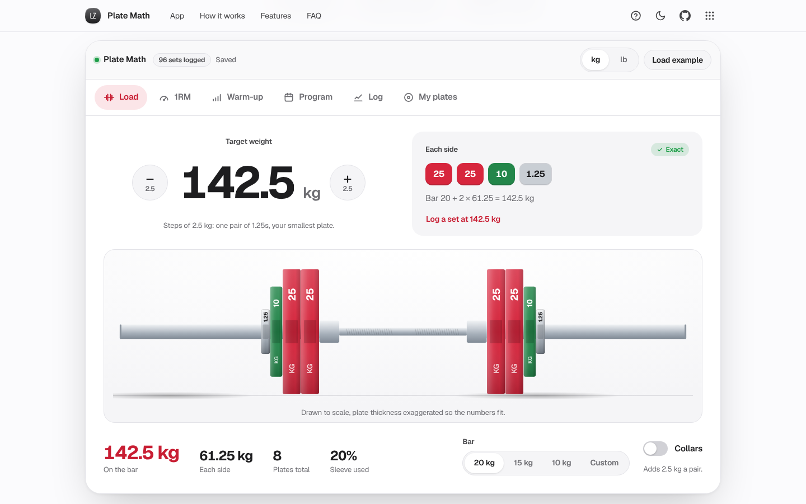

# Plate Math

Know what goes on the bar. A gym companion for your phone: plate loader, 1RM, warm-ups, 5/3/1 and a training log.

[](https://lz-plate-math.pages.dev/)

Mirror: https://lazarzec18.github.io/plate-math/



## Features

**Load the bar**
- Type a target, or tap minus and plus. The step is one pair of your smallest plate (2.5 kg with 1.25s, 1 kg once you add 0.5s).
- A side-on barbell drawn to scale in competition colours, with the weight printed on every plate. Plates slide on as the weight changes.
- Per-side plate list, a breakdown (bar + 2 × per side), sleeve usage and a warning if the plates won't fit on a 415 mm sleeve.
- When a weight can't be made exactly, the closest loadable weights below and above, one tap to load either.
- Kilograms or pounds, each with its own plate set (lb: 45/35/25/10/5/2.5) and colours. Bars: 20, 15, 10 kg; 45, 35 lb; or custom. Collars toggle.

**1RM**
- Weight × reps with Epley, Brzycki and Lombardi, and their average as the headline number.
- Reps and RPE mode using the standard RPE chart (5 reps at RPE 8 = 81.1%).
- A 50–100% table rounded to loadable weights, each row with Load this.

**Warm-up**
- A ramp from the empty bar to your working weight, every set rounded to your plates and loadable in one tap.
- A tick-off list with progress that survives a reload.

**Program**
- 5/3/1 for squat, bench, deadlift and press: training max %, weeks 1–3 and a deload, rounded to loadable weights. Tap any set to load it. Fill 1RMs from your log.

**Log**
- Record sets with exercise (list or custom), weight, reps and date. History grouped by day.
- Estimated 1RM chart per exercise in SVG, with hover, tap and keyboard tooltips.
- PR detection with a badge and toast, delete with undo, CSV export, and an eight-week example data set.

**My plates**
- Pairs of each plate you own (0–20). Every calculation in the app uses only these.

## How it works

The loader halves the plate weight and tries a greedy fill per side: as many of the heaviest plate as fit, limited by the pairs you own, then down the sizes. If that misses, a subset-sum pass over your inventory builds every reachable per-side total with the fewest plates, which also gives the nearest loadable weights below and above. The same set of loadable totals rounds the 1RM table, the warm-up ramp and the 5/3/1 weeks, so every number in the app is one you can actually put on the bar. All arithmetic runs in hundredths to avoid floating-point drift.

The barbell is an SVG built from real plate diameters and thicknesses. Thickness is exaggerated by one factor everywhere so labels fit and plates stay in proportion; new plates animate in with the Web Animations API, skipped under reduced motion. The log stores each set with its unit, so switching between kg and lb converts history and the chart without losing data. A set is a PR when its estimated max beats every earlier set of that exercise.

## Tech

- Vanilla HTML, CSS and JavaScript. No framework, no build step.
- Zec Labs kit (`zl.css`, `zl.js`) for layout, components, toasts, dialogs, the guided tour and storage.
- Inline SVG for the barbell and the progress chart.
- `localStorage` via `ZL.store` for all state.
- Geist from Google Fonts.

## Run locally

```sh
python3 -m http.server
```

Then open http://localhost:8000.

## Project structure

| File | What it does |
| --- | --- |
| `index.html` | Page: hero, the six-tab app, how it works, features, FAQ |
| `logic.js` | Pure maths: plate solver, 1RM, RPE chart, warm-up, 5/3/1, PRs, CSV, example data |
| `bar.js` | Draws the to-scale barbell |
| `chart.js` | Estimated 1RM line chart with tooltips |
| `app.js` | UI, state, persistence and the guided tour |
| `styles.css` | App styles on top of the kit |
| `zl.css`, `zl.js` | Shared Zec Labs kit (unchanged) |
| `_headers` | Cloudflare Pages headers |

## Testing

A Python Playwright suite (120 checks) drives the app with real clicks and typing:

- Plate loading: exact loads, closest options, too-light targets, steppers, collars, 15 kg and custom bars, plate colours and printed weights.
- Pounds mode: conversion, lb bars and plate set, 225 lb = two 45s a side.
- Inventory limits: owning one pair of 25s, the 0 and 20 pair limits, and the step following the smallest pair.
- 1RM formulas, the percentage table and Load this; RPE e1RM (100 × 5 at RPE 8 = 123.3).
- Warm-up ramps and ticks; 5/3/1 week-1 numbers for a known training max.
- Log: validation, PR detection, chart rendering and tooltips, delete with undo, CSV export, example data.
- Persistence across reload, the guided tour, reduced motion, no horizontal scroll at 390 px, 44 px targets and no console errors.

---

Part of Zec Labs, a set of small, polished web apps by [Lazar Zec](https://github.com/LAZARZEC18). See them all at https://lazarzec.pages.dev/
